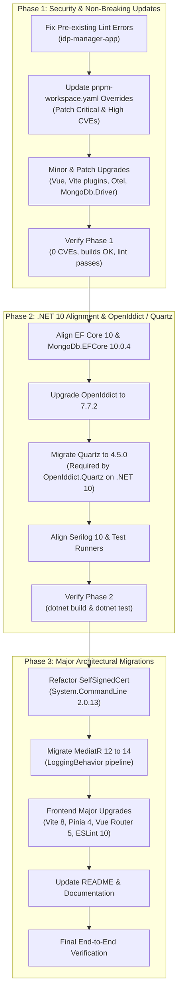

# Repository Dependency Upgrade Strategy (Overview)

> **Document ID:** `000_dependency_upgrade_overview`  
> **Status:** Draft / Planned  
> **Created:** 2026-10-13  
> **Target Framework:** .NET 10.0 (`net10.0`) & Vue 3 / Vite (pnpm workspace)  

---

## 1. Executive Summary

This document outlines the overarching strategy to safely analyze and upgrade all **.NET (backend)** and **JavaScript (frontend)** dependencies across the repository.

The repository currently exhibits:
- **.NET Backend:** Builds successfully, but emits **32 security warnings (`NU1902`/`NU1903`)** due to outdated transitive dependencies in MongoDB, OpenTelemetry, and SSH.NET (via Testcontainers).
- **JS Frontend (`idp-manager-app`):** Builds successfully, but contains **12 vulnerabilities (1 Critical, 6 High, 4 Moderate)** in `pnpm audit`, caused by outdated dependencies and obsolete overrides in `pnpm-workspace.yaml`. Pre-existing lint errors block CI lint checks.

To avoid regression and manage inter-package constraints (such as OpenIddict, Quartz, MongoDB, and System.CommandLine), the upgrade is segmented into **three sequential, independently verifiable phases**.

---

## 2. Phase Breakdown & Execution Sequence

---

## 3. Detailed Phase Plan Index

Each phase has a dedicated plan file in this directory with explicit file targets, package versions, code snippets, execution commands, and verification criteria:

| Phase | Plan Document | Scope & Goal | Estimated Effort |
| :--- | :--- | :--- | :--- |
| **Phase 1** | [`001_phase1_security_and_non_breaking_updates.md`](file:///C:/CodeWorkspace/projects/apogeedev.identityprovider/docs/plans/001_phase1_security_and_non_breaking_updates.md) | Remediate all 12 frontend CVEs (including critical `shell-quote`), fix 32 .NET NU190x vulnerability warnings, fix pre-existing lint issues, and apply safe minor/servicing patches. Zero breaking code changes. | Low |
| **Phase 2** | [`002_phase2_dotnet10_ecosystem_and_openiddict_quartz.md`](file:///C:/CodeWorkspace/projects/apogeedev.identityprovider/docs/plans/002_phase2_dotnet10_ecosystem_and_openiddict_quartz.md) | Coordinated alignment of `MongoDB.EntityFrameworkCore 10`, `Microsoft.EntityFrameworkCore.Design 10`, `OpenIddict 7.7.2`, `Quartz.Extensions.Hosting 4.5.0`, and `Serilog 10`. | Medium |
| **Phase 3** | [`003_phase3_major_architectural_migrations.md`](file:///C:/CodeWorkspace/projects/apogeedev.identityprovider/docs/plans/003_phase3_major_architectural_migrations.md) | Code refactor for `System.CommandLine 2.0`, `MediatR 14.2`, `Vite 8`, `Pinia 4`, `Vue Router 5`, and `ESLint 10`. | Medium / High |

---

## 4. Key Rules of Engagement & Guardrails

1. **Follow Repository Guidelines:**
   - Always adhere to [`AGENTS.md`](file:///C:/CodeWorkspace/projects/apogeedev.identityprovider/AGENTS.md).
   - Never commit secrets or credentials.
   - For frontend changes: run `pnpm lint` and `pnpm format` before committing.
2. **Git Hygiene:**
   - Commit after the completion and verification of each phase.
   - Branch naming suggestion: `feat/dependency-upgrades-phase-<number>`.
3. **Docker Dependency for Testing:**
   - Integration tests in [`ApogeeDev.IdentityProvider.Host.IntegrationTests`](file:///C:/CodeWorkspace/projects/apogeedev.identityprovider/src/ApogeeDev.IdentityProvider.Host.IntegrationTests/ApogeeDev.IdentityProvider.Host.IntegrationTests.csproj) rely on `Testcontainers.MongoDb`. Ensure the Docker daemon is running before executing `dotnet test`.
